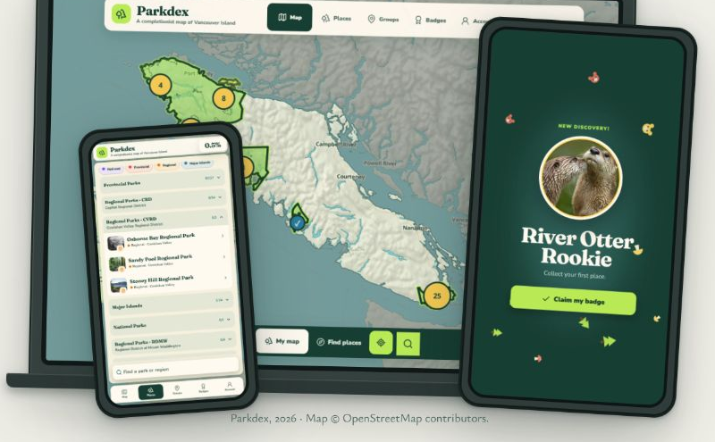
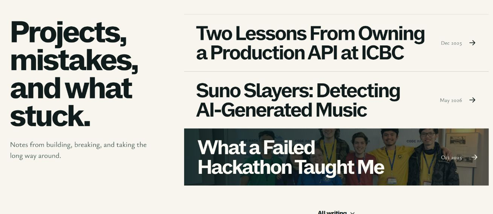

<!-- Hallmark review: Philosophy 5, Hierarchy 5, Execution 5, Specificity 5, Restraint 5, Variety 4 -->
# Homepage assets and SEO follow-up

Baseline: `2ea43b0`. Implementation: `d06ffc5`. Deployed review: [staging](https://staging.nathanpannell.com). Production remains unchanged until explicit promotion.

The approved desktop claim is larger, while the photograph, transparent masthead, and mobile composition stay intact. The Parkdex gallery uses the three supplied screenshots at their full source proportions: the island map, otter badge, and places checklist. Existing matte hardware is retained.

Each of the six standalone writing entries now has a specific background/social image. Graduation, the failed hackathon, and Echo retain real article photographs. ICBC, Suno Slayers, and Record of the Day use newly generated, text-free conceptual still lifes. They do not replace documentary images or technical diagrams inside articles. Built-in image generation was used; exact prompts and original paths are preserved in `public/media/writing/*.webp.json` and ASSETS.md.

## Technical SEO

- Unique descriptions, Open Graph and Twitter previews, and useful image alternatives for every standalone essay.
- Homepage Person/WebSite and article BlogPosting JSON-LD with factual author, URL, publication date, and image.
- Canonical www HTTPS URLs on content routes. The 404 document is noindex and has no canonical.
- Host-scoped noindex headers for Pages origins, branch previews, and staging. Production is excluded from those rules.
- Intrinsic project cover dimensions, a brand favicon, and the Doxxme HTTPS link.
- One-day revalidating media cache and immutable fingerprinted CSS/assets, with no overlapping global cache rule.

The host rules follow [Cloudflare Pages header documentation](https://developers.cloudflare.com/pages/configuration/headers/). HTML retains [Pages' default revalidation](https://developers.cloudflare.com/pages/configuration/serving-pages/). Noindex is exposed to crawlers rather than blocked in robots.txt, consistent with [Google's indexing guidance](https://developers.google.com/search/docs/crawling-indexing/block-indexing).

## Verification

`npm run build` passed the content contract, Astro diagnostics, static generation, and the new generated-output SEO contract. Live [HTTP evidence](live-seo.json) confirms all 12 intended staging routes, noindex host rules, 404 metadata and status on a missing route, and exact cache header values. Production remains on the previous commit and has no noindex header; production changes are prepared but not deployed.

Deployed browser checks passed: all six writing background bindings, keyboard focus and archive expansion, Record of the Day navigation, Back then Scroll, accurate article metadata, and no observed console errors. The [independent visual/code review](finish-review.md) returned **ship** with no material issue across 320, 375, 414, 768, 1280, 1440, and 1920px hero captures, the Parkdex gallery, image assets, and SEO source. Crops accompany this report.

Search Console ownership, sitemap submission, indexing outcomes, and field Core Web Vitals were not verified. Staging's social image URLs intentionally point to the production canonical domain and become publicly available there after promotion.

## Before and after

| Surface | Approved baseline | Follow-up |
| --- | --- | --- |
| Desktop claim |  |  |
| Parkdex |  |  |
| Writing |  |  |

The generated ICBC background was also inspected in its live keyboard-focus state: 
