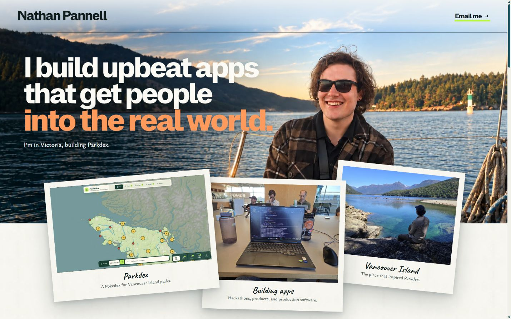
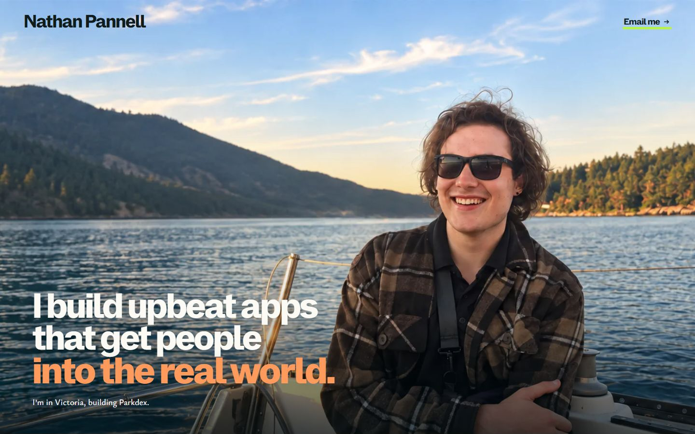
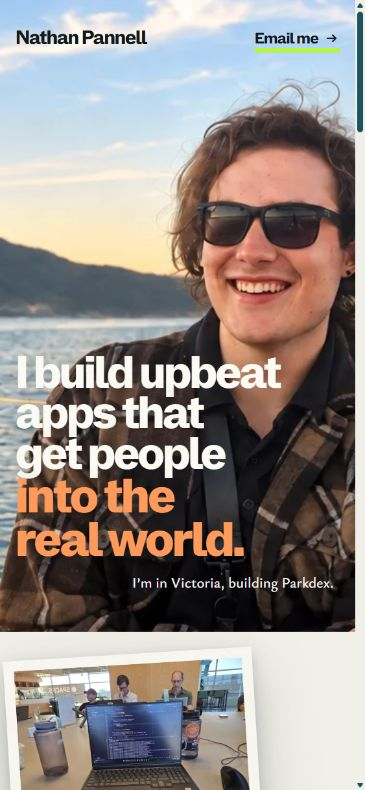
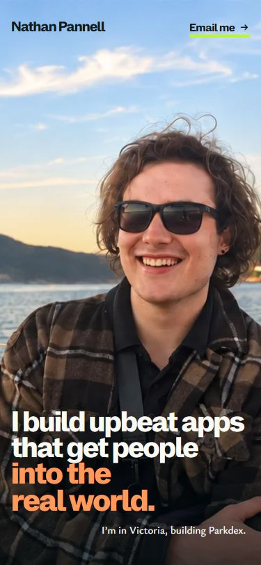
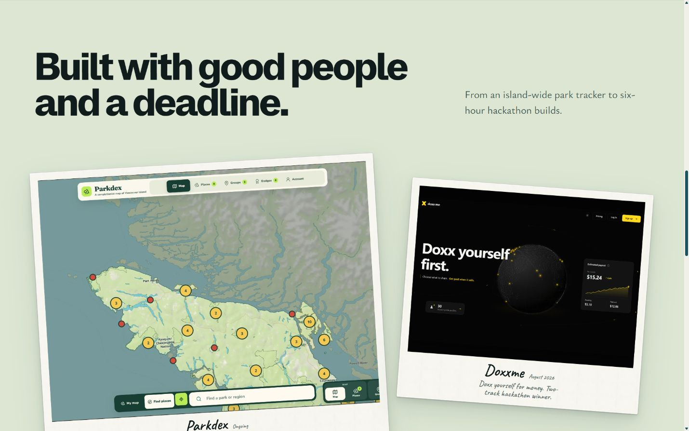
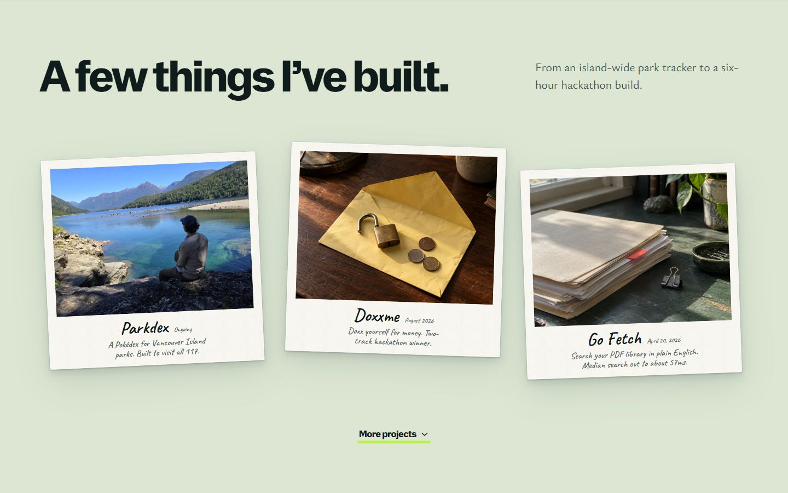
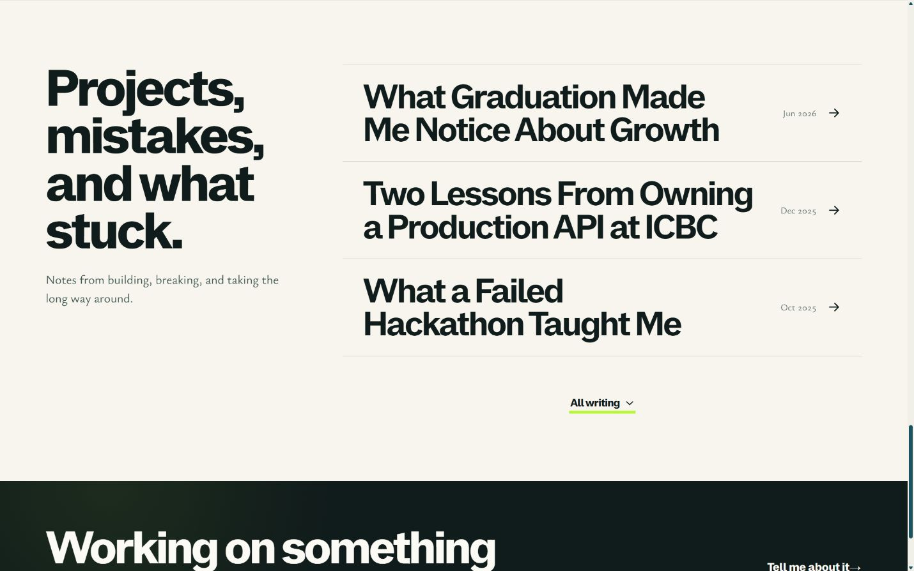

# Homepage finish, 21 September 2026

The homepage now uses one continuous sailboat photograph, a transparent header without a divider, and a lower-left headline. The old desktop exposure plate, white masthead wash, partial-height image, and overlapping hero prints no longer compete in the opening composition.

The selected projects are Parkdex, Doxxme, and Go Fetch. Together they show a live personal product, an unusual collaborative hackathon, and measurable systems work. The covers use Nathan's island photograph and two generated conceptual still lifes. Product screenshots and technical diagrams remain on the detail pages.

The selected essays are the ICBC production API lessons, Suno Slayers, and the failed hackathon reflection. Commons, Cup of Sugar, Graduation, Echo, and Record of the Day remain accessible through native archives. Every existing content URL is retained.

## Verification

- `npm run build`: content contract passed, Astro reported zero diagnostics, 13 static pages built.
- All 12 intended content URLs returned HTTP 200 on staging.
- Deployed header: computed border is 0px and background image is none.
- Deployed project journey: Doxxme, Back, then Scroll correctly selected Go Fetch and cleared link focus.
- Project archive opened by keyboard and linked to Commons. Writing archive opened by keyboard and exposed the three older essays without project duplicates.
- Suno Slayers has a specific description and a working repository link in place of the broken PDF URL.
- Browser console: no errors observed during the tested journeys.
- Image provenance scan: all 10 scanned hero, plate, and new cover rasters have provenance records.
- Impeccable detector: font-size and radius documentation advisories only. Existing unrelated design-system drift was not expanded into this change.

Independent visual review returned **ship**, with no material fixes. The reviewer inspected the 320, 375, 414, 768, 1280, 1440, and 1920px layouts, full desktop/mobile pages, and focused hero/project/writing crops. Screenshots establish the tested layouts, not every browser/device combination. See [the full verdict](finish-review.md).

## Before and after

| Surface | Before | After |
| --- | --- | --- |
| Hero |  |  |
| Phone hero |  |  |
| Project deck |  |  |
| Writing |  |  |

## Delivery

Review on [staging](https://staging.nathanpannell.com). Source commit: `6d260c4`. Production promotion is a separate action. [Pull request](https://github.com/NathanPannell/portfolio-2026/pull/1).
