# Open issues #4 through #8 visual review

Before images are from the live production site on September 23, 2026. After images are from the combined candidate's local production build at the same viewport sizes. The draft PR preview and persistent staging release are verified separately before delivery.

| Issue | Before | After |
| --- | --- | --- |
| #4, hero subtext size |  | 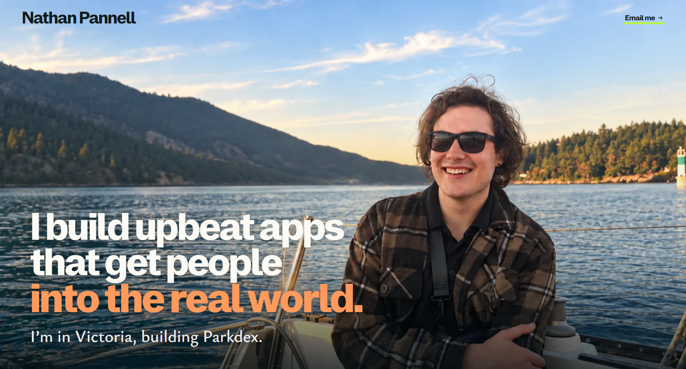 |
| #5 and #6, Parkdex frames and waitlist link | 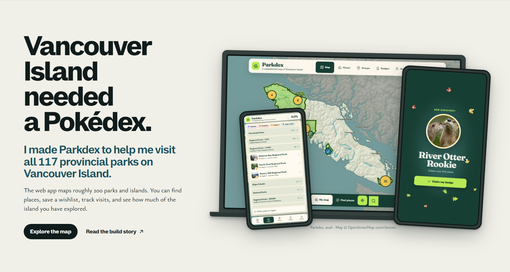 | 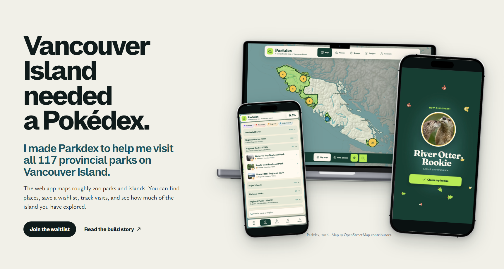 |
| #7, project intro height | 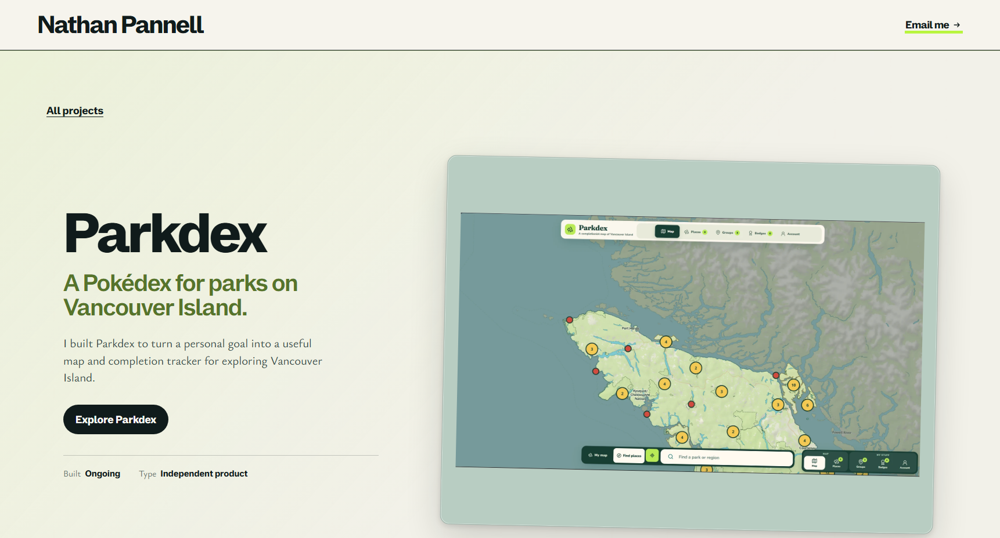 | 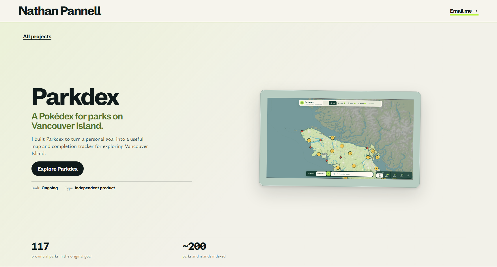 |
| #8, detail media flow | 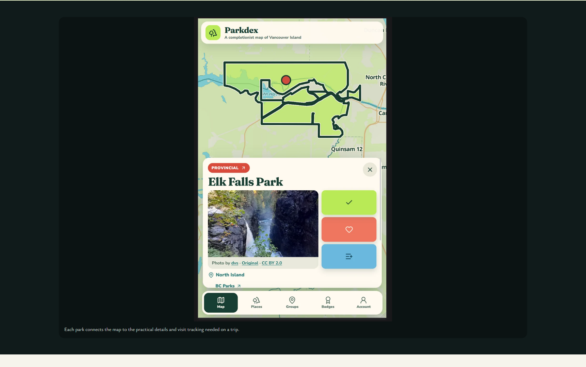 | 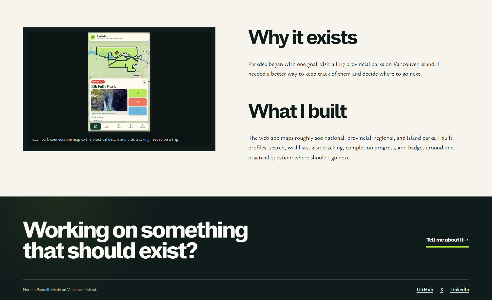 |
| Phone homepage | 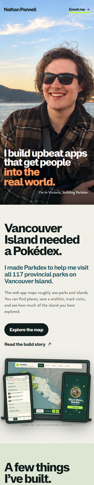 | 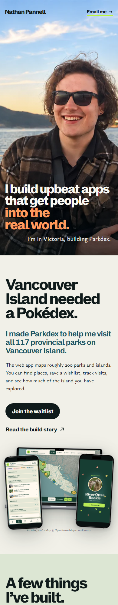 |
| Phone project page | 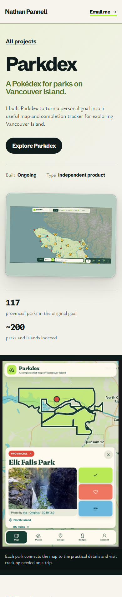 | 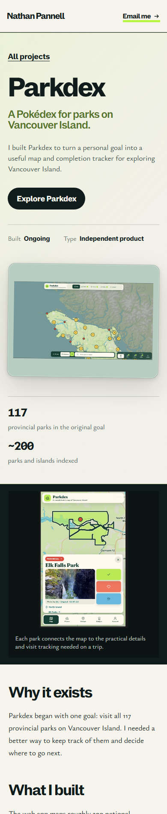 |

Local production build passed the content contract, Astro diagnostics, static generation, and SEO contract. Browser checks at 1707×791, 768×900, 390×844, and 320×700 found no page errors, failed requests, or horizontal overflow on the affected journeys. At 1707×791, the homepage subtext and masthead are both 42.4px, the project intro ends at the viewport edge, and the Parkdex detail image is 301px tall, or 38% of viewport height. The phone subtext and masthead are both 20px.
