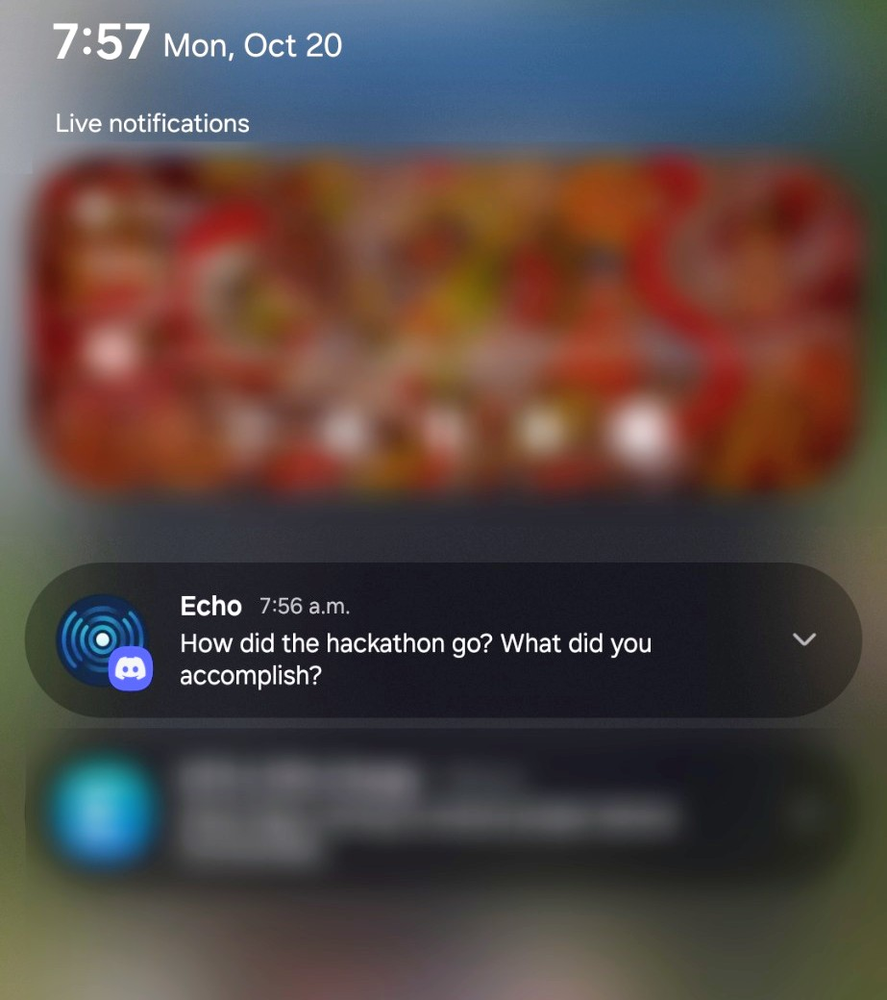

Most journaling apps wait on your home screen for you to remember they exist. Echo messages you first.

It's a proactive accountability bot that lives in Discord and nudges you for quick updates through the day. Under the hood it uses the OpenAI API to write context-aware check-ins and follow-ups, with a timing model that decides when to reach out next instead of pinging you on a fixed schedule. At the end of the day it hands back a summary of where your time went, in text and audio.

We built it over a weekend hackathon. A few things came out of it that I keep coming back to.

---

## What it does today

- Follow-up messages timed dynamically rather than on a fixed schedule
- End-of-day summaries of how the day actually shook out
- Audio versions of those summaries for listening on the go

---

## Lesson 1: Borrow a platform that already reaches everyone

Building a productivity app usually means building the app, the notification system, and a client for every device someone might use. Echo skips all of that by living inside Discord. Discord already runs on phone, desktop, and web, already handles push notifications, and already gives you a chat interface people know how to use. The bot only has to be smart; the delivery comes for free.

Wrapping intelligence around an existing messaging platform buys you multiplatform reach and proactive push the day you ship, instead of spending your first month rebuilding infrastructure that already exists.

---

## Lesson 2: Proactivity is how a productivity tool survives low motivation

Productivity tools churn hard because they mostly work when you're already motivated, and a motivated user is the one who needs the least help. The person who actually needs a journaling habit is the one in a slump, and the slump is exactly when the app gets deleted.

Echo's answer is to not wait. Because it reaches out on its own schedule, it keeps working through the stretches where a passive app would sit forgotten behind a folder on the second home screen. Survive the low-motivation valleys and the habit sticks far better than anything that depends on the user choosing to open it.

---

## Lesson 3: Hackathons reward what the judges can see

Echo was clever where it counted, and a chat bot is a hard thing to show off on a projector. Flashy visuals do a lot of the persuading in a hackathon room, and a slick dashboard lands faster in a two-minute demo than a smart conversation does. It's a useful constraint to design around: if the interesting work lives underneath the surface, build a visible layer that puts it on display so the judges feel what you feel about it. Next time I'll spend some of the weekend making the substance easy to see.

---

Echo runs on FastAPI, Discord.py, the OpenAI API, and MongoDB Cloud, deployed with docker-compose on a Hetzner VM. Next on the list: long-term conversation memory, quick-reply options, and support for more platforms like Telegram and WhatsApp.

It started as a weekend build, but the problem it goes after stays interesting to me: closing the gap between how you meant to spend your day and how you spent it.

[View Accountability Bot on GitHub](https://github.com/NathanPannell/Accountability-Bot)

---

## Addendum: OpenClaw

A month or so after this, an open-source project called OpenClaw (originally ClawdBot) started to take off, and it leans on the exact idea behind Lesson 1. It's a personal AI agent that uses the messaging apps you already have as its interface, WhatsApp, Telegram, Discord, and dozens more, so it inherits reach and proactive push instead of shipping its own app. It went from a weekend project to one of the most-starred repos on GitHub in a few months.

I didn't build it, and Echo is a much smaller thing. But watching it blow up was a decent confirmation that the harness-on-existing-platforms approach has legs well past a hackathon toy. Worth a look if the pattern here interests you.
