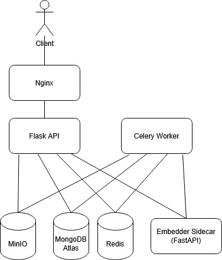
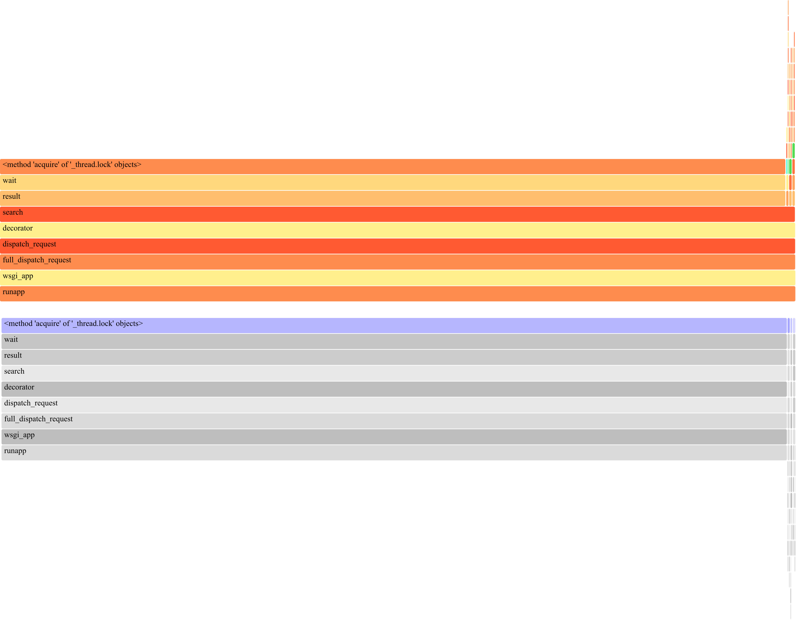
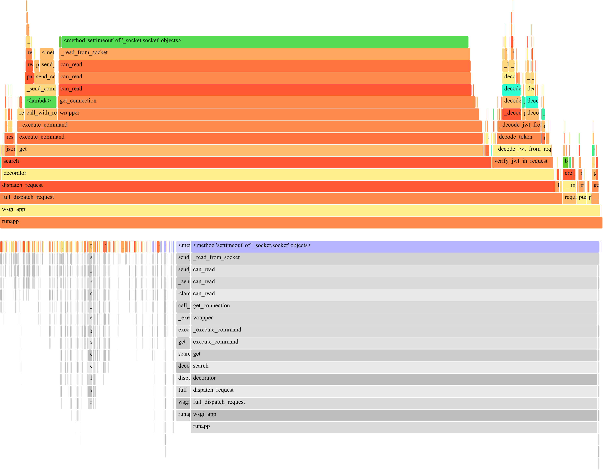

How many services does it take to search a PDF?

For this project, the answer turned out to be six: Flask, Celery, Redis, MongoDB, MinIO, and a dedicated embedding sidecar. I wanted to see how far I could push a distributed semantic search system, complete with signup, login, PDF upload, and natural-language search over your own document library, and find where it actually breaks under load instead of just getting it working on my laptop with one user hammering it.

This post is mostly about the agentic coding workflow behind it, and the tradeoffs of forcing six services to behave like one system.

---

## The Workflow: Issue → Claude Code → PR → Review → Merge

Since this was solo, "team collaboration" meant me and Claude Code, coordinated entirely through GitHub Issues.

The loop looked like this:

1. I have an idea for a feature or fix.
2. I ask Claude Code to interview me about it until the requirements are actually clear.
3. It drafts a GitHub Issue from that conversation.
4. I revise the issue until it says what I actually want, and post it.
5. Claude Code (usually Opus in plan mode, Sonnet for execution) implements it on a branch and opens a PR.
6. I review line-by-line in the GitHub UI, leave comments, and iterate until it merges.

Take [PR #18](https://github.com/NathanPannell/go-fetch/pull/18), which centralized the embedding model into its own sidecar. The issue called for two separate priority queues: one for latency-sensitive search embeddings, one for throughput-sensitive PDF indexing. The first pass merged the two queues instead of keeping them separate. After a couple of review comments didn't fix it, I rewrote that part myself, restructuring the module and pulling the queues fully apart.

Other PRs went the opposite way. [PR #16](https://github.com/NathanPannell/go-fetch/pull/16), the two-layer Redis cache, had a few significant issues on first read: an N+1 Redis fetch, missing error handling, a TTL that was incorrect. I left comments, Claude Code addressed all of them correctly in one follow-up push, and I merged without touching the code myself. Here I was just reviewer and product manager.

Issue #11 ("Flask can't handle concurrent requests") turned into issue #13 ("also fix connection pool exhaustion and a signup race condition") the moment load testing showed the actual failure modes.

---

## Decision Tradeoffs

A few of the tradeoffs that shaped this project:

**Flask over FastAPI.** Minimal opinionation, clean integration with the Python ML stack. FastAPI would've been a fine alternative too; this came down to familiarity more than a hard technical win.

**One database doing two jobs.** MongoDB Atlas Local holds both metadata and vectors. Since users never share data, a single shard can serve a user's entire traffic, so collapsing two stores into one made the docker-compose setup simpler and the query path uniform. The cost showed up later: the Atlas Local image is a single-node replica set that flatly refuses to become a real cluster. I tried scripting `rs.initiate()` across multiple nodes and kept hitting quorum failures and cluster-ID mismatches. Mongo was never the bottleneck anyway, so I dropped it. The real fix for production is hosted Atlas or a dedicated vector DB like Qdrant.

**One Redis doing two jobs.** Same logic, less pain: Celery broker and search cache share a Redis instance instead of splitting across Redis and RabbitMQ. Profiling never showed Redis as a bottleneck, so the combined role held up.

**The embedding sidecar.** This was the big one. Early on, the embedding model (`all-MiniLM-L6-v2`) was loaded inside every Flask and Celery process, up to 16 copies at once. A profiler trace of a "slow" 1.94s search request showed 1.91s of it blocked on a thread lock, waiting for the model to free up in another thread.

Pulling the model into its own FastAPI sidecar dropped live model copies from 16 to 1 and freed ~1.4GB of RAM. The model itself was still CPU-bound, saturating 11 of 14 cores under load:

Switching from `sentence-transformers` + PyTorch to `fastembed` (ONNX Runtime, quantized) cut embedding time 3-5x and halved peak RAM on top of that.

**The cache.** The load test rotates through the same 10 search terms across every virtual user, so a two-layer Redis cache turned repeated searches into near-instant lookups. A cache hit finished in 7ms, almost entirely inside a single Redis `GET`.

---

## Did It Actually Scale?

Short answer: after fixing the above, yes, but only up to the CPU ceiling.

Search p50 went from 1,500ms to ~57ms at the 10-user baseline. Throughput under stress testing went from 0.09 req/s to 26.1 req/s. Failure rate dropped from double digits to zero. None of that raised the actual capacity: embedding inference is CPU-bound, and once the sidecar saturates the available cores, more concurrent users just queue behind the same budget. On a single physical machine, adding more Flask replicas even made things _worse_, since they competed for cores that were already maxed out.

My instinct when something's slow is always "add more of it," which apparently only works if the hardware is independent too.

---

Solo project, but with Claude Code doing the implementing and me doing the reviewing, it still felt like working with someone.

Check out the repo!

[View Go Fetch on GitHub](https://github.com/NathanPannell/go-fetch)
