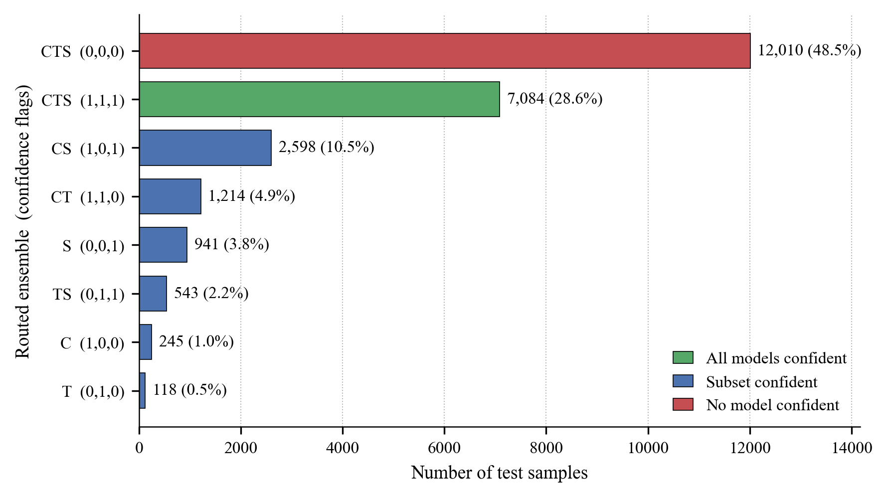

Give Suno a text prompt and thirty seconds, and it hands back a finished song: vocals, lyrics, instruments, all of it. The output is good enough that it's already blending into streaming platforms next to human tracks, which turns "made by a person" into a label nobody can verify. Copyright holders, platform moderators, and listeners all inherit that problem.

I spent a term building a detector for it with [Ryan Dreher](https://github.com/Exophobias) and [Devanshu Makwana](https://www.linkedin.com/in/devanshumakwana/) from UVic.

We trained on the [SONICS dataset](https://github.com/awsaf49/sonics): tens of thousands of real songs paired against AI tracks from Suno and Udio. The usual approach reads a [spectrogram](https://en.wikipedia.org/wiki/Music_information_retrieval) and hunts for audio artifacts. We added a second signal from the lyrics, then combined everything into an ensemble. Three findings came out of it that hold up well beyond music detection.

---

# Finding 1: Different models fail in different places, and that's the whole point of ensembles

The headline result of the project was not that fusing models pushed accuracy higher. It was _why_ it pushed higher. Each of our three detectors had a distinct blind spot, and a properly built ensemble let the others cover for it. The gain came from complementary failure modes.

Getting there took one detour first. The naive way to combine models is late fusion: take the CNN's output, the transformer's output, and the lyrics embedding, feed all three into one small network, and let it learn the weights. That worked on average and then broke on chirp-v2, the Suno generator with the least training data.

Here's what happened. The CNN had never learned chirp-v2, so it was wrong on those tracks. Worse, it was confidently wrong rather than uncertain. Naive fusion weighs every input the same, so those loud incorrect CNN votes buried the transformer and lyrics models even when both were right. The ensemble scored worse than its own parts.

The fix was confidence gating. I trained separate fusion heads holding out each combination of input modalities (I.e. just the transformer or just the CNN + Lyrics embeddings). At inference time, when any input model's confidence dropped below a learned threshold, the final prediction was routed to a head that only included confident predictions. F1 on the hardest generator went from 0.55 to 0.85, and overall accuracy across every generator hit the best number we recorded, 0.98.

I learned that an ensemble is not automatically more robust than its parts. It absorbs the failure mode of whichever model speaks loudest, and a confidently wrong model does more damage in a blend than an uncertain one. The value came from designing the system to lean on a different modality exactly where one went blind.

---

# Finding 2: Your detector has an expiration date

I built the lyrics classifier, and was surprised how simple it was. Plain [TF-IDF](https://en.wikipedia.org/wiki/Tf%E2%80%93idf) word counts into a logistic regression beat a fine-tuned [sentence-embedding](https://huggingface.co/sentence-transformers/all-MiniLM-L6-v2) model. AI-generated lyrics carry an obvious statistical fingerprint that shallow patterns already catch.

Every set of lyrics in the dataset was written by GPT-4o. So what my classifier really learned to spot is GPT-4o's writing style, which is a proxy for AI music rather than the thing itself. Improve the underlying language model, or swap in a different one, and that fingerprint fades.

That's the structural problem with any AI-detection product. You are detecting one particular version of a generator, and the signal decays every time that generator gets an update. If detection is your business, the decay curve _is_ your business, and a feature that works today can quietly stop working after the next model release.

---

# Finding 3: Difficulty depended on data more than architecture

One pattern showed up across every model we trained, including the CNN and transformer my teammates built. The detectors generalized almost perfectly to a Suno version they had never seen in training, as long as a similar version was well represented. They collapsed on the generator with the fewest training examples, regardless of how the model was built.

It's the recurring story in applied ML: time spent gathering and polishing data gives better return than architecting a beautiful model design, at least for more straightforward classification tasks. The generalization you get for free from adjacent examples can make a major difference.

---

As my most ambitious AI research project to date, this work showed me how competitive the current GenAI detection arms race truly is. A detector is only as good as its understanding about what it's chasing, and that target moves every time someone ships a better generator.

The transformer and CNN internals, with all the numbers, are in the [full report](https://github.com/NathanPannell/Suno-Slayers/blob/main/Multimodal%20Late%20Fusion%20for%20Robuest%20AI-Generated%20Music%20Detection.pdf).

[View Suno Slayers on GitHub](https://github.com/NathanPannell/Suno-Slayers)
