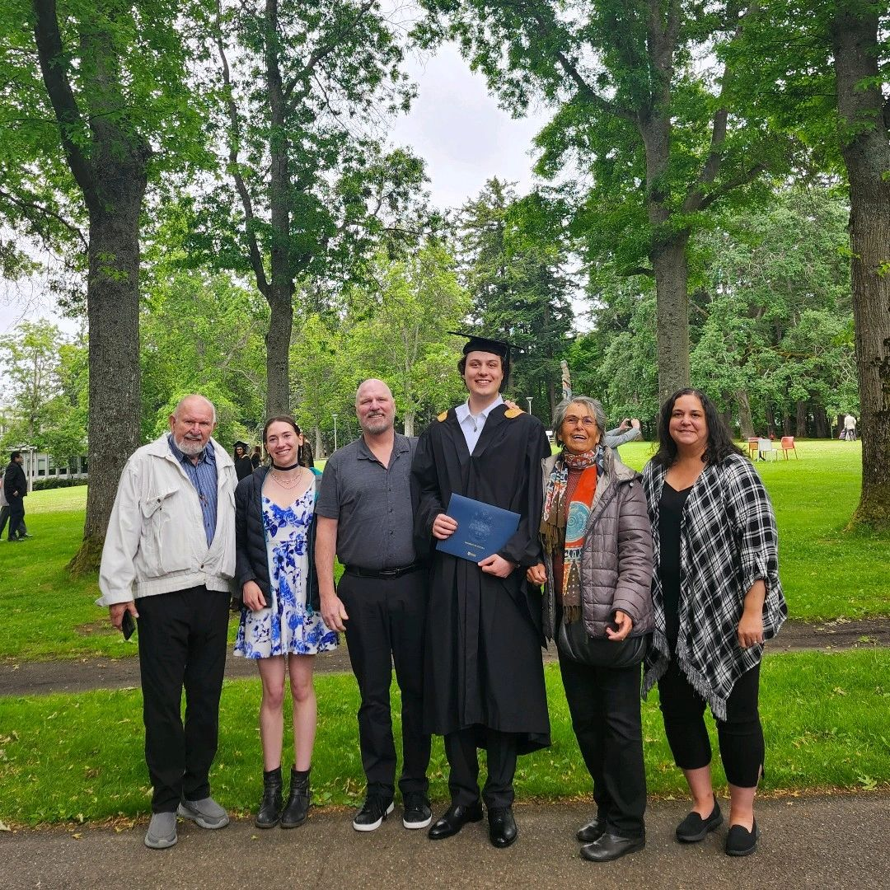
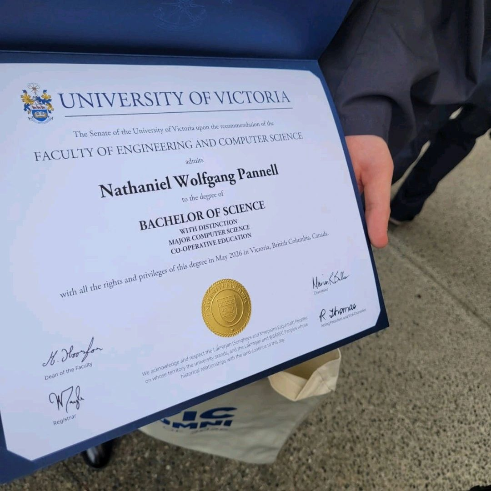
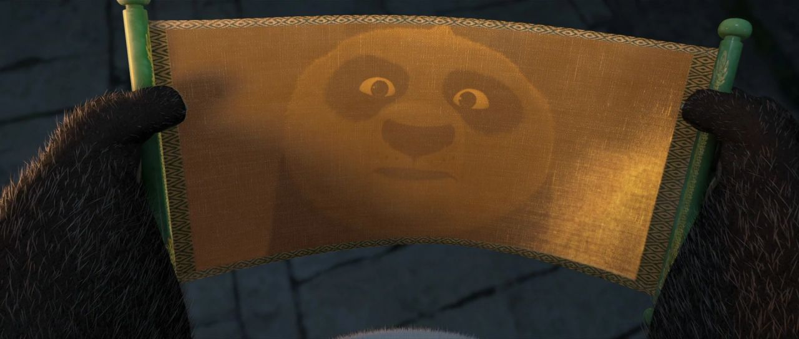

Last month I graduated from the University of Victoria, and getting that degree didn't change anything about me, but it helped me realize how growth works.

Growth is slow and continuous. It happens a little at a time, on ordinary days you don't even notice. But looking backwards, your brain doesn't see the slow climb. It marks the progress in steps: your first semester, your first job, your degree. The milestones are just the places where you stop and notice how far you've come.

I was the same person the day I moved into residence as the day before. But that first weekend, without my friends, family, or dog, something grew that nobody clapped for.

I was the same person the day my second year grades came in as the day before. But the all-nighters and study sessions in Vertigo with classmates built a work ethic I'll carry for the rest of my life.

I was the same person the day I convocated as the day before. But that piece of paper was never the point. It was the years of studying and exams, the friends who got me through them, and the connection I built with Vancouver Island exploring with the Outdoors Club. Progress made on quiet evenings, one small step at a time.

It reminds me of the end of Kung Fu Panda. Po finally opens the Dragon Warrior Scroll, the thing that's supposed to hold the secret to unlimited power, and it's completely blank. All he sees is his own reflection.

The paper doesn't give you the power; it was already inside you. The degree just helped me see it.
