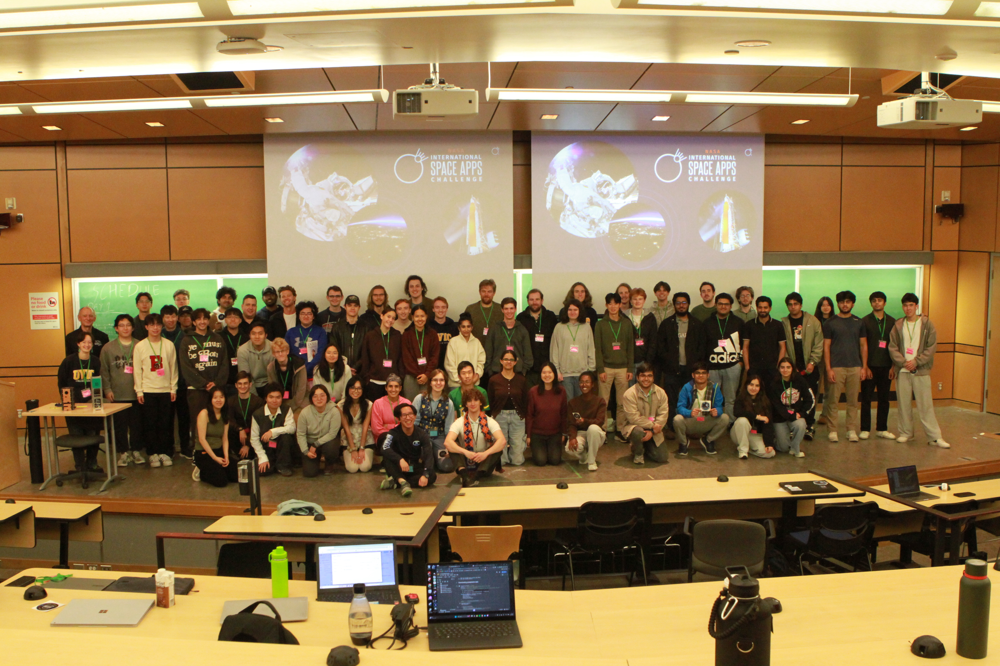
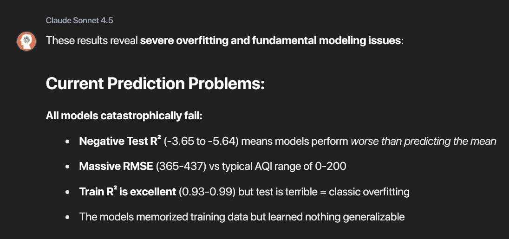
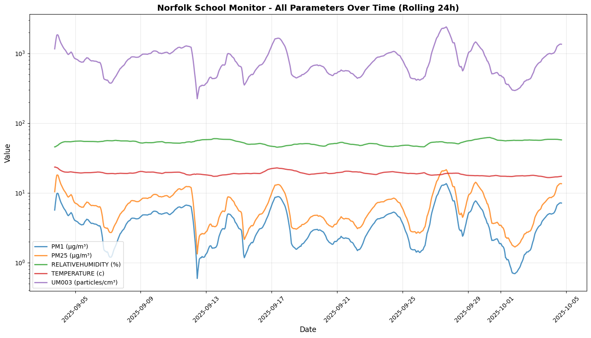
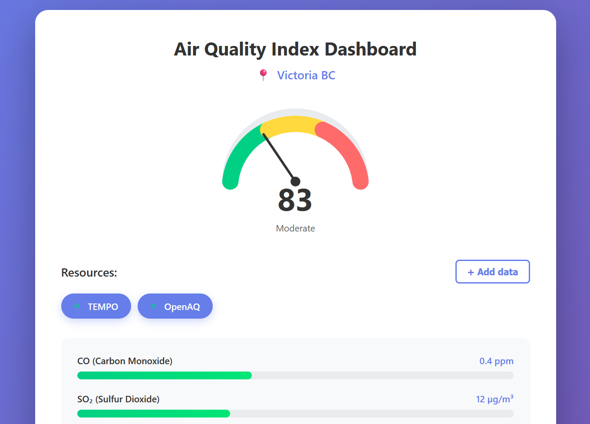
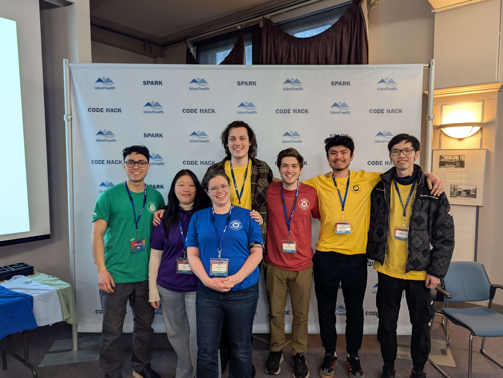

## I recently participated in [NASA's Space Apps Challenge](https://www.spaceappschallenge.org/) for 2025. It did not go as well as I had hoped.

After escaping from data wrangling-hell with a handful of hours to submission, I was finally able to train some machine learning models and test our team's idea.
When I saw the results, I reflected on everything that went wrong over the past 48 hours and how I didn't want that to happen again.

To prepare for future hackathons, this post will review the issues encountered and how to address them going forward.

---

## Lesson 1: Be flexible during ideation

The biggest challenge we faced was due to committing to a direction too early. This can (and in our case did) lead to a dead end if your solution is fundamentally flawed.
In my team's case, we were attempting to solve the [EarthData to Action](https://www.spaceappschallenge.org/2025/challenges/from-earthdata-to-action-cloud-computing-with-earth-observation-data-for-predicting-cleaner-safer-skies/) challenge which involved using real-time satellite data to model air pollution on the ground.
While the challenge is interesting enough for a weekend project, I wanted to try a more novel approach: modeling air quality with non-pollutant data.

The vision was to create a platform that can connect to any live data stream and use it to predict air quality.
My plan for this was to train a regression model targeting the hourly Air Quality Index (AQI) values from [OpenAQ](https://openaq.org/).
By training on time and location-stamped data, I was going to predict air quality via the live-streamed weather data.
With a limited number of features in my test data sources (five pollutants and three meteorological measurements), I decided to train two models: a shallow neural network and random forest.

Unfortunately, meteorological data (humidity, temperature, wind) has a weak correlation with air quality since pollutants are largely driven by emissions, not weather. I didn't realize that the correlation was this low until it was too late.

Solution: Spend time researching domain-specific information

One of the most underrated things to take away from a weekend hackathon (in addition to the snacks, of course) can be a newfound appreciation for a domain that you're not familiar with.
For example, I naturally learned quite a bit about air quality modeling. But focusing on deliberately researching this earlier would have been wise to avoid the mistakes that I can now see clearly in hindsight.

While it was unfortunate that my realization came so late into the process, there were moments early on where friction points could (and should) have been opportunities to pivot into a more fruitful direction.

---

## Lesson 2: Know your stack

This is more obvious, but it's worth mentioning that having a strong foundation in a tech stack can make a hackathon go much smoother.
The process of going from a challenge to an idea to a fleshed-out solution can be a daunting amount of work on its own.
If you spend most of your time following tutorials on how to work with UseEffect, it's going to be hard to end up with a project that you're proud of...

In a rush to get a working site, my team ended up using a React frontend built by Claude.
The team's lack of frontend experience ended up being a major blocker as we were unable to easily revise the AI-generated mockup ourselves.
I want to keep it simple but understandable next time and use some basic HTML, CSS, and JavaScript if we're unable to quickly iterate with frameworks.

Solution: Learn a simple tool in depth

While hackathons are great places to learn new skills, it's helpful to determine what you want to get out of it.
If you want to practice your machine learning skills with Pytorch, it's helpful to avoid also learning React and Flask at the same time.

I will try to focus on a specific tool in my next hackathon and study it in advance to make the most of the problem-solving aspect of the hackathon, not just the battling with a new framework...

---

## Lesson 3: Work with a diverse team

During my previous hackathon ([CodeHack 2025](https://www.codehack.ca/)), team formation required one of each of the following roles:

- Allies: Support the healthcare system and can advocate for ideas.
- Builders: Engineers and developers who build the technical solutions.
- Frontline: Healthcare workers who work with patients.
- Patients: Provide insight into areas of high impact.
- Designers: Create user-friendly interfaces and concepts.

This diversity in terms of technical expertise, design skills, and domain knowledge proved critical for identifying the root of the problem and creating an impactful solution.
For reference, our issue involved the lack of access to culturally sensitive healthcare services for Indigenous Peoples in British Columbia.

The solution we developed, after two days of brainstorming was a [RateMyProfessors](https://www.ratemyprofessors.com/)-style ranking for healthcare providers.
This would be reported by patients from different communities and would be used to recommend the best healthcare providers for them based on their needs.
This was a wide departure from the original, highly technical plan which involved an AI-translation app, but it fit the heart of the problem more accurately.

Solution: Involve mentors and outsiders in brainstorming sessions

After coming home from the hackathon, I explained the trials and tribulations of the project to my partner.
As a non-technical environmental studies major, she immediately questioned why I would attempt to model pollution with meteorology data.
Something that hadn't occurred to me until the failure of my models was immediately clear to her.

This set of fresh eyes and perspective would have been critical to save the project and pivot into a more feasible solution.
From my experience, this "engineer-splaining" is a common trend in hackathons.
It occurs when a team of engineers designs and implements a solution to a problem without involving domain experts or end users.
In my next hackathon, I want to pitch my idea to many different people throughout the weekend to catch the issues that I am blind to.

---

Overall, I learned a lot from this hackathon, just not in the ways that I expected.

This experience has taught me that a failed project can teach you more than a polished demo if you're willing to learn from it.
